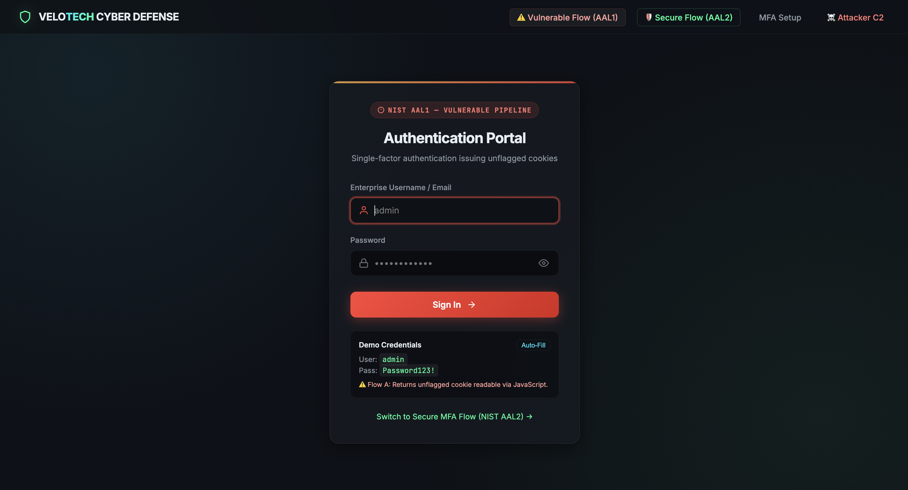
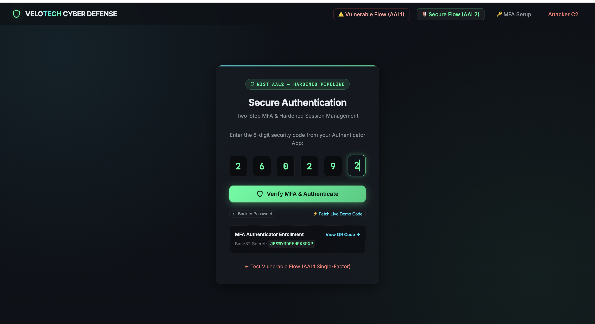
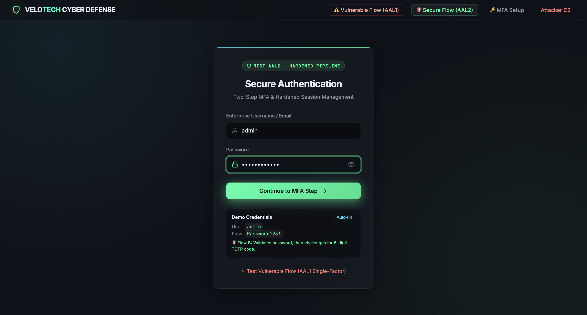
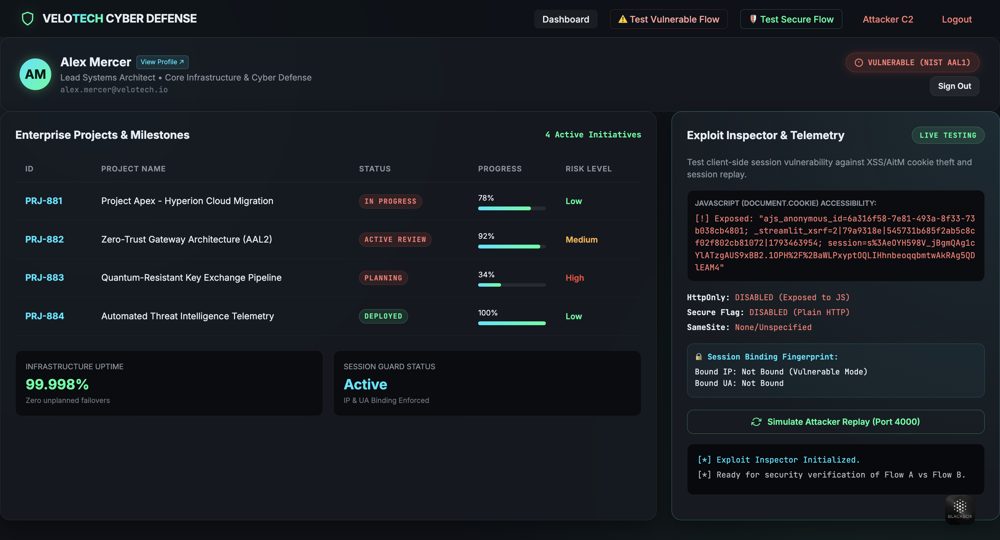
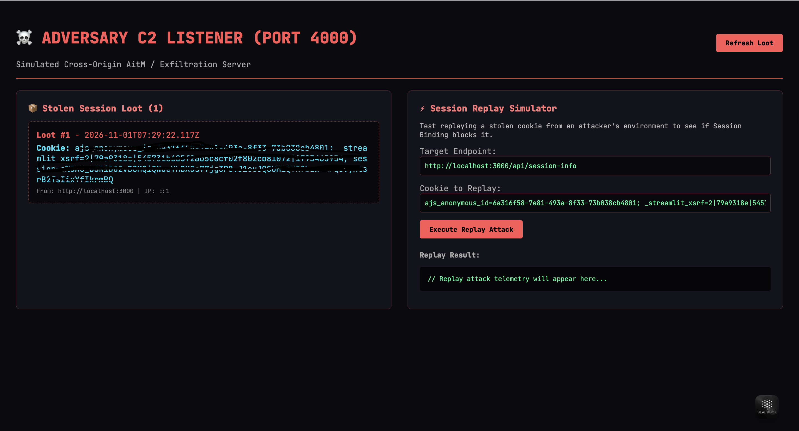

# 🛡️ VeloTech Cyber Defense: NIST SP 800-63B Authentication PoC

[](https://nodejs.org/)
[](https://expressjs.com/)
[-007acc)](https://pages.nist.gov/800-63-3/sp800-63b.html)
[](https://owasp.org/Top10/)
[](LICENSE)
[](#-security-disclaimer)

An interactive, full-stack cybersecurity laboratory demonstrating the real-world impact of **NIST SP 800-63B Authenticator Assurance Level 1 (AAL1 - Single-Factor + Unflagged Cookies)** versus **NIST SP 800-63B Authenticator Assurance Level 2 (AAL2 - Multi-Factor + Hardened Cookies + Session Binding)**.

---

## 📸 Interface & Exploit Showcase

Here is a visual walkthrough of the authentication, defense, and attack simulation flows:

### 1. Authentication Flows & Telemetry
<p align="center">
  
  
</p>
<p align="center">
  
  
</p>

### 2. Malicious Adversary C2 & Replay Simulator (Port 4000)
<p align="center">
  
</p>

---

## ⚡ Executive Summary: AAL1 vs AAL2

| Security Control | 🔴 Vulnerable Implementation (NIST AAL1) | 🟢 Hardened Implementation (NIST AAL2) |
| :--- | :--- | :--- |
| **Authentication Factors** | Single Factor (Memorized Secret / Password only) | Multi-Factor (Password + Time-Based One-Time Password / TOTP) |
| **Cookie `HttpOnly` Flag** | ❌ **Omitted:** JavaScript has direct access via `document.cookie` | ✅ **Enforced:** Strictly inaccessible to client-side scripts (mitigates XSS token theft) |
| **Cookie `Secure` Flag** | ❌ **Omitted:** Cookie transmitted over unencrypted HTTP | ✅ **Enforced:** Browser transmits cookie strictly over encrypted HTTPS/TLS |
| **Cookie `SameSite`** | ❌ **Unspecified / None** | ✅ **`Strict`:** Blocks cross-site request forgery (CSRF) vectors |
| **Session Binding** | ❌ **None:** Anyone possessing the token can impersonate the victim | ✅ **Active Fingerprint Verification:** Bound to client IP and User-Agent fingerprint |
| **Session Hijacking Replay** | ❌ **Vulnerable:** Replay succeeds on Malicious C2 Listener | ✅ **Defended:** Server detects environment mismatch and revokes session (HTTP 401) |

---

## 🔑 Demo Credentials

This PoC includes pre-configured mock credentials for demonstration and testing:

| Role | Username | Password | Base32 TOTP Secret |
| :--- | :--- | :--- | :--- |
| **Lead Systems Architect** | `admin` | `Password123!` | `JBSWY3DPEHPK3PXP` |

> *Note: These are mock credentials hardcoded strictly for local educational demonstration. Never use real credentials or production secrets.*

---

## 🧪 Interactive Testing Scenarios

### Flow A: The Attack Simulation (NIST AAL1 Vulnerability)
1. Open **`https://localhost:8443/login-vulnerable`** (or `http://localhost:3000/login-vulnerable`).
2. Click **Auto-Fill** and submit the credentials.
3. The server authenticates with a single factor and issues an **unflagged cookie**:
   ```http
   Set-Cookie: session=s%3A...; Path=/
   ```
4. You land on the Dashboard with the red **VULNERABLE (NIST AAL1)** telemetry badge.
5. In the **Exploit Inspector & Telemetry** panel on the right, click **Execute Attack Demo (`document.cookie`)**.
6. **Result:**
   - JavaScript successfully extracts the active session token from `document.cookie`.
   - The payload immediately exfiltrates the token to the malicious Attacker C2 Server at `http://localhost:4000/loot`.
7. Navigate to **`http://localhost:4000`** to view the stolen session token captured in the adversary's loot console.

---

### Flow B: The Secure Mitigation (NIST AAL2 Defense)
1. Open **`https://localhost:8443/mfa-setup`**:
   - Scan the rendered QR code with **Google Authenticator**, **1Password**, or **Authy**.
   - A live 30-second countdown monitor shows the synchronized OTP in real-time.
2. Navigate to **`https://localhost:8443/login-secure`**:
   - **Step 1 (Primary Factor):** Enter `admin` / `Password123!` and submit. The UI smoothly cross-fades to the MFA challenge screen without a full page reload.
   - **Step 2 (Secondary Factor):** Enter the 6-digit TOTP code (or click **⚡ Fetch Live Demo Code**).
3. The server validates both factors and issues a **hardened session cookie**:
   ```http
   Set-Cookie: session=s%3A...; Path=/; HttpOnly; Secure; SameSite=Strict
   ```
4. You land on the Dashboard displaying the green **SECURE (NIST AAL2)** telemetry badge.
5. In the Exploit Inspector, click **Execute Attack Demo (`document.cookie`)**:
   - **Result:** `document.cookie` returns empty. The browser's security sandbox refuses JavaScript access to the session token.
6. Click **Simulate Attacker Replay (Port 4000)**:
   - The Attacker Server attempts to reuse the stolen cookie with a spoofed Kali/Adversary User-Agent.
   - **Result:** The `sessionBinding` middleware detects the environmental anomaly, destroys the compromised session, and returns `HTTP 401 Session Hijack Blocked`.

---

## 🚀 Quick Start Guide

### 1. Prerequisites
- **Node.js**: `v18.0.0` or higher
- **NPM**: `v9.0.0` or higher
- **OpenSSL** or **mkcert** (for local HTTPS certificate generation)

### 2. Clone & Install
```bash
git clone https://github.com/<your-username>/velotech-security-poc.git
cd velotech-security-poc
npm install
```

### 3. Generate Local SSL/TLS Certificates
Required for HTTPS and testing the `Secure` cookie flag:
```bash
npm run certs
```
*Automatically detects `mkcert` or falls back to an OpenSSL self-signed certificate stored in `server/certs/` (ignored by git).*

### 4. Run the Servers
Open two terminal windows:

**Terminal 1 — Main Application Server:**
```bash
npm start
```
* Main HTTPS Portal: **`https://localhost:8443`**
* HTTP Testing Endpoint: **`http://localhost:3000`**

**Terminal 2 — Malicious Adversary C2 Server:**
```bash
npm run attacker
```
* Attacker C2 Dashboard: **`http://localhost:4000`**

### 5. Automated Verification Test Suite
Run the end-to-end security test suite to verify all compliance rules:
```bash
node scripts/verify-poc.js
```
The test suite validates:
- [x] Vulnerable route emits unflagged cookie without `HttpOnly` or `SameSite=Strict`
- [x] Attacker C2 server successfully receives exfiltrated cookie
- [x] Secure 2-step authentication enforces MFA before granting session
- [x] Secure route sets `HttpOnly`, `Secure`, and `SameSite=Strict`
- [x] Session binding rejects replay requests with spoofed User-Agents (`HTTP 401`)

---

## 📂 Architecture Overview

```
velotech-security-poc/
├── .env.example             # Template for optional custom environment variables
├── .gitignore               # Excludes node_modules, private keys, certs, and .env
├── package.json             # Scripts & dependencies
├── assets/                  # Showcase media and diagrams
│   └── screenshots/         # Screenshots for GitHub README
├── server/
│   ├── app.js               # Dual HTTP/HTTPS Express application entry point
│   ├── routes/
│   │   ├── vulnerable.js    # /login-vulnerable (NIST AAL1, unflagged cookie)
│   │   ├── secure.js        # /login-secure (NIST AAL2, 2-step TOTP flow)
│   │   └── dashboard.js     # /dashboard & /api/session-info protected telemetry
│   ├── middleware/
│   │   ├── sessionBinding.js# Validates client IP & User-Agent against bound session
│   │   └── authCheck.js     # Session existence & authorization gate
│   ├── data/
│   │   └── users.js         # In-memory mock user store & demo TOTP secret
│   └── certs/               # Local SSL/TLS certificates (.pem files ignored by git)
│       └── .gitkeep
├── public/                  # Frontend UI with Cyber-Minimalism Design System
│   ├── css/
│   │   └── style.css        # Glassmorphic cyber theme & animations
│   ├── js/
│   │   ├── attack.js        # Document.cookie exploit & C2 exfiltration simulation
│   │   ├── dashboard.js     # Telemetry polling & interactive exploit controls
│   │   ├── mfa-setup.js     # QR code rendering & live 30s TOTP countdown
│   │   ├── secure-login.js  # 2-step smooth cross-fading UI controller
│   │   └── vulnerable-login.js
│   ├── dashboard.html       # Enterprise Project Management & Telemetry UI
│   ├── login-secure.html    # AAL2 2-step login view
│   ├── login-vulnerable.html# AAL1 single-factor login view
│   └── mfa-setup.html       # Interactive authenticator enrollment page
├── attacker-server/
│   └── attacker.js          # Standalone C2 listener & session replay simulator (Port 4000)
└── scripts/
    ├── generate-certs.js    # Cross-platform TLS cert provisioner (mkcert / OpenSSL)
    └── verify-poc.js        # Automated end-to-end verification test suite
```

---

## 📸 Screenshots Included in this Repository

The visual walkthrough is documented in `assets/screenshots/`:
- `login-vulnerable.png` — Single-factor unflagged AAL1 login.
- `mfa-setup.png` — Scannable TOTP QR enrollment with live countdown monitor.
- `login-secure.png` — Smooth cross-fading 2-step MFA challenge.
- `dashboard.png` — Enterprise dashboard with live Exploit Inspector telemetry.
- `attacker.png` — Standalone C2 listener (Port 4000) capturing exfiltrated tokens and testing replay attacks.

---

## 🛡️ Repository Security & Safe Git Push

This repository has been configured with strict secret hygiene:
- ✅ **`.gitignore`** automatically ignores `node_modules/`, `.env` files, `.DS_Store`, and all private SSL/TLS keys (`*.pem`, `*.key`).
- ✅ **SSL/TLS Certificates** generated by `npm run certs` stay on your local machine and will not be pushed to GitHub.
- ✅ **Demo Credentials** are explicitly mock values (`Password123!` / `JBSWY3DPEHPK3PXP`) designed exclusively for demonstration.

### Recommended Steps to Initialize and Push to GitHub:
```bash
# 1. Initialize git repository
git init

# 2. Check what will be tracked (verify certs and node_modules are excluded!)
git status

# 3. Add and commit files
git add .
git commit -m "feat: initial commit for VeloTech NIST AAL1 vs AAL2 security PoC"

# 4. Create your remote repository on GitHub and link it
git branch -M main
git remote add origin https://github.com/<your-username>/velotech-security-poc.git

# 5. Push securely
git push -u origin main
```

---

## ⚠️ Security Disclaimer

This project is created strictly for **educational and authorized security evaluation purposes**. All attack simulations (token exfiltration, session replay) are constrained to local testing ports (`localhost`). Do not deploy mock credentials or unflagged session endpoints in production systems.

---

## 📄 License

This project is licensed under the **ISC License**. See the `package.json` file for details.
